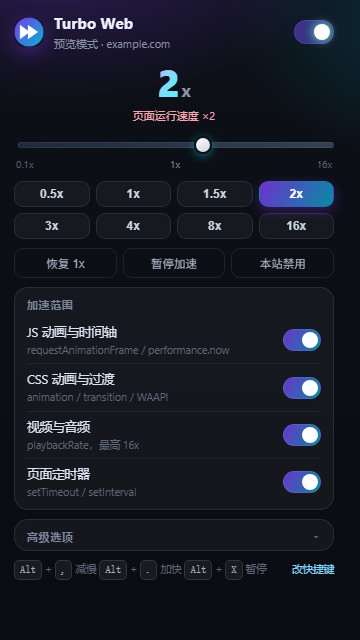
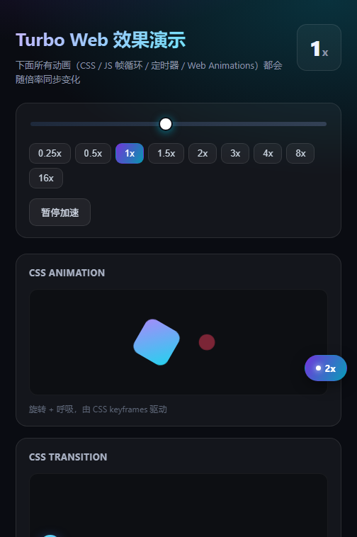
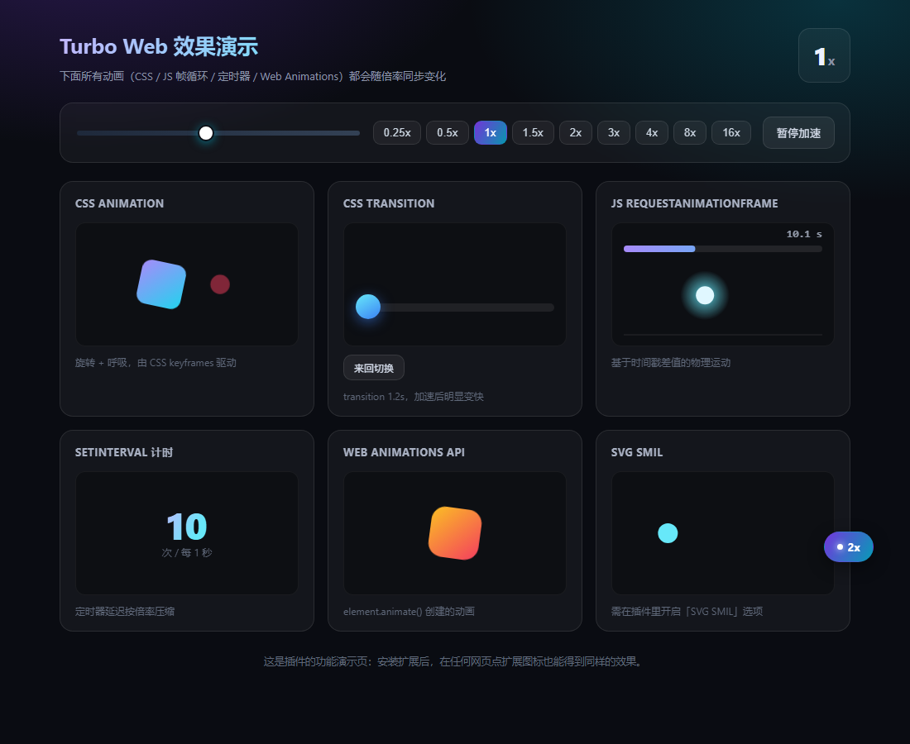

<div align="center">

# Turbo Web · 网页全局加速

**给整个网页加速的浏览器扩展 —— CSS 动画 / JS 时间轴 / 视频音频 / 页面定时器，0.1x ~ 16x 自由调节**

[](https://github.com/SharpBio/web-turbo/actions/workflows/ci.yml)
[](LICENSE)
[](manifest.json)
[](#兼容性)
[](#安卓安装)
[](tools/engine.test.js)

</div>

---

## 为什么需要它

网页动画的速度是写死在页面里的：CSS `animation-duration`、`requestAnimationFrame` 循环、
`setInterval` 轮播、视频的播放速率……想整体放慢或加快，只能逐项去改。
Turbo Web 劫持页面的时间基准，**让整个网页按一个倍率同步运转**——拖一下滑块，
所有动画、定时器、视频音频一起变，互相对齐关系不变。

典型用途：慢放教学视频里的 CSS 演示、加速冗长的开场动画、调试动画时序、
按倍率回看网页上的自动播放内容。

## 加速范围

| 层面 | 手段 | 覆盖对象 |
|---|---|---|
| 虚拟时间轴 | 劫持 `requestAnimationFrame` + `performance.now`，双锚点换算虚拟时间 | GSAP、three.js、ScrollTrigger、自写 rAF 循环等一切「按时间戳差值」推进的动画 |
| Web Animations | 巡检 `document.getAnimations()`，统一设 `playbackRate` | CSS `animation` / `transition` / `element.animate()` |
| 页面定时器 | `setTimeout` 压缩 delay；`setInterval` 改链式调度 | 轮播、自动翻页、心跳计时、倒计时 |
| 媒体 | `video/audio.playbackRate` + `preservesPitch` | 视频、音频（上限 16x，变速不变调） |
| 可选 | SVG SMIL、`Date.now` 劫持、逐帧重复模式 | 老式矢量动画与逐帧动画兜底 |

两个关键设计：

- **变速不跳变**：切倍率时重算双锚点，虚拟时间连续，不会突然前跳或倒退。
- **间隔立即生效**：`setInterval` 采用负数 id 的链式 `setTimeout` 调度，所以拖滑块时
  **已经在跑的**轮播会立刻跟着变快，不用等下一轮。

## 截图

<table>
<tr>
<td width="50%"><br><sub><b>控制面板</b>：对数刻度滑块、档位预设、加速范围开关</sub></td>
<td width="50%"><br><sub><b>手机悬浮控制器</b>：点开调速，可拖动、位置记忆</sub></td>
</tr>
<tr>
<td colspan="2"><br><sub><b>演示页</b>（<code>demo/index.html</code>）：六类动画同时运行，随倍率同步变化</sub></td>
</tr>
</table>

## 安装

### 桌面（Chrome / Edge / 其他 Chromium 88+）

1. 地址栏打开 `chrome://extensions`（Edge 为 `edge://extensions`）
2. 打开右上角「开发者模式」
3. 点「加载已解压的扩展程序」，选择**本仓库目录**
4. 工具栏出现图标，点开即是控制面板

### 安卓安装

[狐猴浏览器](https://lemurbrowser.com/)（Lemur）、Kiwi 等支持扩展的安卓浏览器：

**方式一 · 安装本地扩展（.crx，推荐）**

```bash
node tools/build.js          # 产出 dist/web-turbo-<ver>.crx
```

1. 把生成的 `.crx` 传到手机并保存到文件中
2. 狐猴浏览器 → 菜单 →「设置」→「安装本地扩展」
3. 文件选择器里选中该文件，确认
4. 安装过程若弹出版本提示，忽略即可

**方式二 · 加载已解压的扩展程序**

把仓库打成 zip 传到手机并解压成文件夹，然后
`chrome://extensions` → 开发者模式 →「加载已解压的扩展程序」选中该文件夹。

### 兼容性

| 环境 | 支持情况 |
|---|---|
| Chrome / Edge 88+（MV3 起点） | 完整支持 |
| 狐猴浏览器（Chromium 107） | 完整支持，主界面用悬浮控制器 |
| Kiwi 等 Yandex/Chromium 系安卓浏览器 | 支持 |
| Firefox | **不支持**（MV3 的 `world: "MAIN"` 与注入机制差异较大，欢迎 PR） |
| `chrome://` 等浏览器内置页 | 无法注入，面板会提示 |

> **为什么能兼容到 Chromium 107**：manifest 里的 `world: "MAIN"` 是 Chrome 111 才有的字段，
> 老内核遇到它直接判定扩展损坏。本项目改用「隔离世界插入
> `<script src="chrome-extension://…">`」把引擎送进页面主世界，Chrome 88 起通用。
> 详见 [docs/ARCHITECTURE.md](docs/ARCHITECTURE.md#注入机制三级保障)。

## 使用

### 手机上：页面内悬浮控制器

手机没有工具栏图标也点不到 popup，所以扩展会在**每个页面右下角**放一个小胶囊：

- **点一下**展开面板：慢 / 快微调、7 个常用档位（0.5x ~ 8x）、暂停加速、隐藏
- **按住拖动**挪到任意位置，位置按站点记忆
- 显示「已暂停」表示当前页面未加速

在 popup 的「高级选项 → 页面内悬浮控制器」可全局关闭。

### 桌面上：控制面板 + 快捷键

| 快捷键 | 作用 |
|---|---|
| `Alt` + `.` | 加快 |
| `Alt` + `,` | 减慢 |
| `Alt` + `X` | 暂停 / 恢复 |
| `Alt` + `Shift` + `X` | 恢复原始速度 1x |

改键位：`chrome://extensions/shortcuts`（面板右下「改快捷键」可跳转）。

面板还提供：恢复 1x、本站禁用、按站点分别记忆、加速范围逐项开关。

## 项目结构

```
.
├── manifest.json              # MV3 清单
├── src/
│   ├── inject.js              # 主世界加速引擎（虚拟时间轴 / 定时器 / WAAPI / 媒体）
│   ├── fallback.js            # 隔离世界降级引擎（只依赖 DOM，任何站点可用）
│   ├── content.js             # 桥接层：注入引擎、读写存储、徽标、快捷键落库
│   ├── floating.js            # 页面内悬浮控制器
│   ├── background.js          # service worker：快捷键分发、徽标、引擎源码分发
│   └── shared.js              # 三处共用的常量与纯函数
├── popup/                     # 控制面板
├── demo/                      # 可直接打开的动画演示页
├── docs/
│   ├── ARCHITECTURE.md        # 架构与注入机制详解
│   └── images/                # README 截图
└── tools/
    ├── engine.test.js         # 引擎行为单元测试（Node + vm）
    ├── build.js               # 打包 zip + 自签 CRX3
    ├── csp_server.py          # 下发严格 CSP 的测试服务器
    ├── make_icons.py          # 生成图标
    └── verify/                # 浏览器端验证页
```

## 开发

环境要求：Node 18+（仅用于跑测试和打包，运行时不依赖任何 npm 包）。

```bash
# 单元测试：引擎行为 27 项断言
node tools/engine.test.js

# 语法检查全部脚本
node --check src/*.js popup/popup.js

# 打包（产物输出到 dist/）
node tools/build.js
```

浏览器端验证需要本机有 Chromium 系浏览器与 Python：

```bash
python -m http.server 8879                       # 静态服务器
python tools/csp_server.py 8878 self             # 带严格 CSP 头的服务器
msedge --headless=new --load-extension=. \
  --virtual-time-budget=8000 --dump-dom \
  http://127.0.0.1:8879/tools/verify/e2e.html
```

| 验证页 | 检查内容 |
|---|---|
| `tools/verify/index.html` | 真机加速比（设 4x 实测 3.98x） |
| `tools/verify/e2e.html` | 扩展加载、主世界注入、桥接缓存端到端 |
| `tools/verify/csp.html` | 严格 CSP 站点下的注入与降级 |
| `tools/verify/float.html` | 悬浮控制器几何探针 |

设计细节、注入机制与已知取舍见 [docs/ARCHITECTURE.md](docs/ARCHITECTURE.md)。

## 已知限制

- 银行、支付、DRM 视频站建议「本站禁用」：改写 `Date.now` 和定时器可能触发风控
- 高级里的「逐帧重复模式」「改写 Date.now」默认关闭，别随手开
- 倍率 8x 以上 CPU 占用明显上升（相当于让页面以 8 倍速跑逻辑）
- 媒体倍率上限 16x 是浏览器硬限制；CSS 动画的 `playbackRate` 也不保证所有站点可写
- 沙箱 iframe（无 `allow-scripts`）内只能拿到降级能力

## 贡献

欢迎 Issue 和 PR。提交前请阅读 [CONTRIBUTING.md](CONTRIBUTING.md)，
尤其注意其中关于**新增劫持点必须先写测试**的要求。

## 安全

本项目会改写页面的全局函数，属于高敏感面。如发现安全问题请**不要**公开发布，
按 [SECURITY.md](SECURITY.md) 私下报告。

## 许可证

[MIT](LICENSE)
